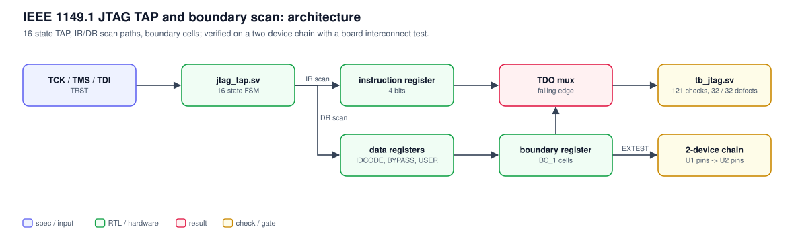
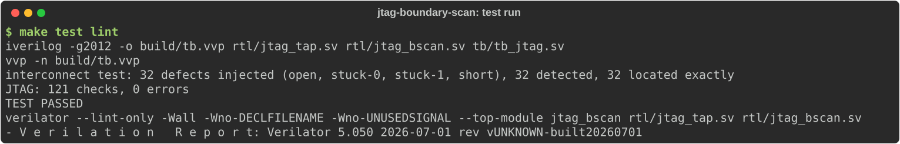

# IEEE 1149.1 JTAG TAP and boundary scan

[](https://github.com/Ana2601/jtag-boundary-scan/actions/workflows/ci.yml)

A complete JTAG TAP controller and boundary-scan wrapper, verified on a two-device scan chain that also runs a board-level interconnect test.



## Design

- `rtl/jtag_tap.sv`: the 16-state TAP FSM, a 4-bit IR (captures `…01`, updates on the falling edge), and asynchronous TRST
- `rtl/jtag_bscan.sv`: boundary register (BC_1-style cells for inputs and outputs), 32-bit IDCODE, bypass, a USER data register, and TDO driven on the falling edge

| IR | Instruction |
|---|---|
| 0000 | EXTEST |
| 0001 | IDCODE (selected by reset) |
| 0010 | SAMPLE / PRELOAD |
| 0011 | INTEST |
| 0100 | CLAMP |
| 1000 | USER (debug/config register) |
| others | BYPASS (1111 mandatory) |

## Verification (`tb/tb_jtag.sv`)

Two devices are daisy-chained (`TDI → U1 → U2 → TDO`). U1's output pins are wired to U2's input pins on a modelled board. The tests cover:

- IDCODE readback for both devices, IR capture pattern, BYPASS single-bit delay
- SAMPLE without disturbing pins; PRELOAD; EXTEST drive and capture; CLAMP; INTEST driving the core
- USER register read and write
- 50 random boundary-register shift-integrity rounds
- TMS reset from any state, which releases the pins and returns to IDCODE
- **Interconnect test**: walking-1 and walking-0 patterns through EXTEST, with injected board defects (open, stuck-0, stuck-1, wired-AND short) on every net

## Results (measured)

| Check | Result |
|---|---|
| Directed checks | **121, 0 errors** |
| Board defects injected | 32 (4 types × 8 nets) |
| Detected | **32 / 32** |
| Located to the exact net(s) | **32 / 32** |

## Run

```bash
make test
make lint
make synth
```

## Test run

Output of the CI command (`make test lint`), captured from a local run:



## Limitations / next steps

No BSDL file generation, no IEEE 1500 or 1687 (IJTAG) networks, and no TCK-domain CDC to the core (the core is assumed quiescent during INTEST).

## Setup

- [OSS CAD Suite](https://github.com/YosysHQ/oss-cad-suite-build) (Icarus Verilog, Verilator, Yosys)

```bash
make test
make lint
```

The same commands run in CI on every push (`.github/workflows/ci.yml`).
